# The Neotia University
## Department of Technical & Academic Systems
### HR Change Management & Automation System (HRMS)

---

# Module I: Core Repository & Service Change Management
## End-to-End Graphic Workflow & Lifecycle Specification

| Document Metadata | Specification Detail |
|---|---|
| **Document Identifier** | `DOC-02-GIW-MOD1-CANONICAL` |
| **Project Name** | University HR Change Management & Automation System |
| **Module Covered** | **Module I — Core Repository & Service Change Management** |
| **Institution** | The Neotia University (TNU) |
| **Mentor** | Sandipan Chakraborty |
| **Date** | October 2026 |

---

## 1. Executive Summary & Module Scope

Module I serves as the authoritative institutional single source of truth for all employment records across The Neotia University. Its operational scope encompasses:

1. **Central Employee Master Database (`ENT-MOD1-01`):** Complete demographic, academic, statutory, and contractual records for active faculty and administrative personnel.
2. **Dynamic Organization Chart (`ENT-MOD1-02`):** Live, multi-tier organizational tree visualizing reporting lines, vacant nodes, and structural realignments.
3. **Digital Personal Dossiers (`ENT-MOD1-03`):** Longitudinal career files archiving appointment letters, qualification upgrades, performance letters, and disciplinary records.
4. **Ten Standardized Service Change Formats (`ENT-MOD1-04`):**
   * *Format 3(a):* Basic Salary & Compensation Revision
   * *Format 3(b):* Designation & Promotional Realignment
   * *Format 3(c):* Direct Reporting Authority (Supervisor) Transfer
   * *Format 3(d):* Departmental & School Reassignment
   * *Format 3(e):* Educational & Professional Qualification Upgrade
   * *Format 3(f):* Campus Location & Physical Facility Transfer
   * *Format 3(g):* Banking & Statutory Tax Detail Revision
   * *Format 3(h):* Additional Institutional Responsibility / Secondary Charge (Dean, HOD, Proctor, Warden)
   * *Format 3(i):* Grade Pay Band & Level Progression
   * *Format 3(j):* Employment Cadre Conversion (Contractual to Regular / Probation to Confirmed)
5. **Two-Level Sequential Approval Workflow:** Strict Level-1 (Central HR Operations) and Level-2 (Senior Executive Management) governance gates.
6. **Effective Date Activation Engine:** Automated midnight activation ensuring that master records remain unaltered until `effective_date`, supported by guaranteed transactional outbox synchronization with the University ERP.

---

## 2. Graphic Workflow Diagram (Module I)

```mermaid
%%{init: {'theme': 'base', 'themeVariables': { 'primaryColor': '#1e293b', 'primaryTextColor': '#f8fafc', 'primaryBorderColor': '#38bdf8', 'lineColor': '#64748b', 'secondaryColor': '#0f172a', 'tertiaryColor': '#1e293b'}}}%%
flowchart TD
    %% Styling Classes
    classDef initNode fill:#1e293b,stroke:#38bdf8,stroke-width:2px,color:#f8fafc;
    classDef checkNode fill:#1e1b4b,stroke:#818cf8,stroke-width:2px,color:#ffffff;
    classDef reviewNode fill:#312e81,stroke:#a855f7,stroke-width:2px,color:#f8fafc;
    classDef rejectNode fill:#450a0a,stroke:#f87171,stroke-width:2px,color:#fecaca;
    classDef schedNode fill:#14532d,stroke:#4ade80,stroke-width:2px,color:#f0fdf4;
    classDef actNode fill:#0c4a6e,stroke:#0284c7,stroke-width:3px,color:#ffffff;
    classDef syncNode fill:#064e3b,stroke:#34d399,stroke-width:2px,color:#ffffff;

    subgraph LANE1 ["SWIMLANE 1: INITIATION & CONCURRENCY VALIDATION (HR Ops / Proposing Authority)"]
        direction TB
        M1_START["<b>1. Trigger Change Initiative</b><br/><i>Select Employee from Central Master DB</i>"]:::initNode
        M1_FMT["<b>2. Select Change Format 3(a)–(j)</b><br/><i>Salary, Designation, Supervisor, Department, Transfer,<br/>Bank, Additional Charge, Level, or Cadre</i>"]:::initNode
        M1_CONC{"<b>3. Concurrency Check Guard (BR-M1-004)</b><br/><i>Is target attribute locked by another<br/>in-flight pending change ticket?</i>"}:::checkNode
        M1_BLOCK["<b>Submission Blocked</b><br/><i>Concurrency Alert: Pending Level-1/2 ticket exists</i>"]:::rejectNode
        M1_PAYLOAD["<b>4. Construct Payload & Enclosures</b><br/>━━━━━━━━━━━━━━━━━━━━━━━━━━━━━<br/>• Input Proposed Values (Salary, Role, Dept)<br/>• Select Future <code>effective_date</code><br/>• Mandatory Business Justification (≥20 chars)<br/>• Upload Statutory Proofs to Document Vault"]:::initNode

        M1_START --> M1_FMT --> M1_CONC
        M1_CONC -- " Yes (Field Locked) " --> M1_BLOCK
        M1_CONC -- " No (Clear to Proceed) " --> M1_PAYLOAD
    end

    subgraph LANE2 ["SWIMLANE 2: LEVEL-1 HR OPERATIONS VETTING (Head of HR / HR Ops)"]
        direction TB
        M1_L1{"<b>5. Level-1 Vetting Gate (BP-M1-005)</b><br/>━━━━━━━━━━━━━━━━━━━━━━━━━━━━━<br/>• Check Pay Slabs & Sanctioned Headcount<br/>• Validate University Service & UGC Rules<br/>• Verify Uploaded Certificates & Documents<br/>• Inspect Before-vs-After Data Diff"}:::reviewNode
        M1_L1_RET["<b>Return to Initiator</b><br/><i>Status: RETURNED_FOR_CLARIFICATION</i><br/>Deficiency remarks logged in ticket"]:::rejectNode
        M1_L1_REJ["<b>Formal Rejection</b><br/><i>Status: REJECTED</i><br/>Audit log recorded; ticket closed"]:::rejectNode

        M1_PAYLOAD ==>|"Submit Change Ticket"| M1_L1
        M1_L1 -.->|" Missing Documents / Policy Query "| M1_L1_RET
        M1_L1_RET -.->|" Rectified Resubmission "| M1_PAYLOAD
        M1_L1 -.->|" Policy Violation "| M1_L1_REJ
    end

    subgraph LANE3 ["SWIMLANE 3: LEVEL-2 SENIOR MANAGEMENT SANCTION (Pro-Chancellor / Registrar)"]
        direction TB
        M1_L2{"<b>6. Level-2 Executive Gate (BP-M1-005)</b><br/>━━━━━━━━━━━━━━━━━━━━━━━━━━━━━<br/>• Institutional & Financial Impact Review<br/>• Governing Body / VC Resolution Validation<br/>• Executive Sanction Sign-Off"}:::reviewNode
        M1_L2_REJ["<b>Executive Rejection</b><br/><i>Status: REJECTED_BY_MGMT</i><br/>Executive remarks recorded in audit ledger"]:::rejectNode
        M1_SCHED["<b>7. Transition to Scheduled Invariant</b><br/><i>Status: APPROVED_SCHEDULED</i><br/>Master DB remains unaltered until effective date"]:::schedNode

        M1_L1 ==>|" Level-1 Endorsement Granted "| M1_L2
        M1_L2 -.->|" Budget / Executive Veto "| M1_L2_REJ
        M1_L2 ==>|" Executive Sanction Granted "| M1_SCHED
    end

    subgraph LANE4 ["SWIMLANE 4: PRE-ACTIVATION REVOCATION WINDOW (Prior to Effective Date)"]
        direction TB
        M1_REV_CHK{"<b>8. Revocation Needed?</b><br/><i>Prior to effective_date 00:00:00</i>"}:::checkNode
        M1_REV_ACT["<b>Revoke Scheduled Change (BP-M1-006)</b><br/><i>Status: REVOKED</i><br/>Master DB untouched; cancellation audit logged"]:::rejectNode

        M1_SCHED --> M1_REV_CHK
        M1_REV_CHK -- " Revocation Triggered " --> M1_REV_ACT
    end

    subgraph LANE5 ["SWIMLANE 5: AUTOMATED MIDNIGHT ACTIVATION ENGINE (System Engine Cron)"]
        direction TB
        M1_CRON["<b>9. Midnight Cron Execution (00:01:00 IST)</b><br/><i>Scans for: <code>effective_date <= CURRENT_DATE</code></i>"]:::actNode
        M1_ATOMIC["<b>10. Atomic Master Database Mutation (BP-M1-006)</b><br/>━━━━━━━━━━━━━━━━━━━━━━━━━━━━━<br/>• <b>Master Mutation:</b> Commit new values to <code>employees</code><br/>• <b>Hierarchy Realignment:</b> Recalculate supervisory edges in <code>org_nodes</code><br/>• <b>Dossier Archival:</b> Append sanction letter to <code>digital_dossiers</code><br/>• <b>Immutable Audit:</b> Write before/after JSON diff to <code>audit_logs</code><br/>• <b>Status Transition:</b> Ticket status becomes <code>ACTIVE</code>"]:::actNode
        
        M1_REV_CHK -- " Effective Date Arrives " --> M1_CRON
        M1_CRON ==> M1_ATOMIC
    end

    subgraph LANE6 ["SWIMLANE 6: REAL-TIME NOTIFICATIONS & ERP SYNCHRONIZATION"]
        direction TB
        M1_WS["<b>11. Socket.IO Live Broadcast</b><br/>━━━━━━━━━━━━━━━━━━━━━━━━━━━━━<br/>• Invalidate Org Tree Canvas (<code>org-tree:invalidated</code>)<br/>• Dispatch personal promotion toast to employee<br/>• Refresh departmental hierarchy cache in Redis"]:::syncNode
        M1_OUTBOX["<b>12. Transactional Outbox Pattern (BP-M1-007)</b><br/>━━━━━━━━━━━━━━━━━━━━━━━━━━━━━<br/>• Write payload to <code>outbox_events</code> in local ACID transaction<br/>• BullMQ asynchronous worker polls outbox queue<br/>• Guaranteed delivery push to University ERP platform"]:::syncNode

        M1_ATOMIC ==> M1_WS
        M1_ATOMIC ==> M1_OUTBOX
    end
```

---

## 3. Step-by-Step Workflow Walkthrough

### Step 1: Change Ticket Creation & Concurrency Check
* **Actor:** Central HR Operations Officer (`ACT-HRO`) or Proposing Authority (Dean / HOD per `CONF-01`).
* **Trigger:** Administrative necessity, salary restructuring, promotion, departmental transfer, or receipt of external performance appraisal outcome (`BP-XMOD-004`).
* **System Enforcement (`BR-M1-004`):** When the initiator selects an employee and change format, the system checks whether the target attribute (e.g., `base_salary` or `reporting_officer_id`) is locked by an in-flight ticket currently in `PENDING_LEVEL1` or `PENDING_LEVEL2`.
  * If locked: System displays a Concurrency Guard alert and prevents duplicate submission.
  * If clear: System creates ticket in `DRAFT` state.

### Step 2: Payload Construction & Statutory Proof Upload
* **Inputs:** Initiator selects `effective_date`, inputs proposed attribute values, enters mandatory business justification ($\ge 20$ characters), and uploads digital verification documents to Document Vault (`ENT-SHR-05`).
* **Enclosure Examples:**
  * Format 3b (Promotion): Governing Body / Academic Council resolution.
  * Format 3d (Department Transfer): Inter-departmental transfer memorandum signed by Registrar.
  * Format 3e (Qualification Upgrade): UGC-recognized degree certificate and grade transcript.
* **State Transition:** Ticket transitions from `DRAFT` to `SUBMITTED` $\rightarrow$ `PENDING_LEVEL1`.

### Step 3: Level-1 Review by Central HR Operations
* **Actor:** Head of HR (`ACT-HHR`) / Designated HR Operations Manager.
* **Verification Scope:** Validates university pay scales, tenure eligibility, UGC service rules, and compares the Before-vs-After diff.
* **Branching Logic:**
  * *Discrepancy / Missing Document:* Status transitions to `RETURNED_FOR_CLARIFICATION`. Initiator receives notice with deficiency remarks.
  * *Policy Violation:* Status transitions to `REJECTED`. Ticket is permanently closed with rejection remarks in audit log.
  * *Approved:* HR signs off; ticket transitions to `PENDING_LEVEL2`.

### Step 4: Level-2 Sanction by Senior Management
* **Actor:** Pro-Chancellor / Vice-Chancellor / Registrar (`ACT-PRO` / `ACT-REG`).
* **Review Scope:** Evaluates institutional budget clearance, executive policy alignment, and statutory committee endorsements.
* **Branching Logic:**
  * *Executive Rejection:* Status transitions to `REJECTED_BY_MGMT`.
  * *Sanction Granted:* Ticket transitions to `APPROVED_SCHEDULED`.

### Step 5: The Pre-Activation Revocation Window
* **System Invariant (`BR-M1-005`):** While in `APPROVED_SCHEDULED` status, the active employee master database remains completely unaltered.
* **Revocation Rule:** Prior to 00:00:00 of the scheduled `effective_date`, an authorized Senior Management or HR Administrator can trigger `REVOKE_SCHEDULED_CHANGE`.
  * The record transitions to `REVOKED`.
  * The active master record remains untouched.
  * Cancellation actor ID, reason, and timestamp are captured in the immutable Audit Trail (`ENT-SHR-07`).

### Step 6: Automated Midnight Execution Engine
* **Actor:** Automated System Engine (`ACT-SYS`).
* **Trigger:** Daily cron execution at 00:01:00 IST.
* **Atomic Master Transaction (`BP-M1-006`):**
  1. Identifies all tickets where `status = 'APPROVED_SCHEDULED'` and `effective_date <= CURRENT_DATE`.
  2. Updates target columns in `mod1_core.employees`.
  3. Recomputes reporting edges in `mod1_core.org_nodes`.
  4. Appends formal sanction order into `mod1_core.digital_dossiers`.
  5. Inserts guaranteed event payload into `shared_platform.outbox_events`.
  6. Writes complete before/after JSON diff into `shared_platform.audit_logs`.
  7. Transitions ticket status to `ACTIVE`.

### Step 7: Real-Time Event Dispatch & ERP Outbox Synchronization
* **Real-Time Notification:** Socket.IO gateway emits `org-tree:invalidated` to active web sessions, invalidating client-side hierarchy caches and pushing personal toasts to the affected employee.
* **ERP Outbox Poller (`BP-M1-007`):** BullMQ queue worker polls `outbox_events` and executes bidirectional synchronization with the University ERP platform via approved transport protocol (`REQ-TBD-01`).

---

## 4. State Transition Matrix (Module I)

| Initial State | Event / Trigger | Actor | Target State | Master DB Modified? | Audit Log Generated? |
|---|---|---|---|:---:|:---:|
| None | Create Change Draft | Initiator | `DRAFT` | No | No |
| `DRAFT` | Submit Change Ticket | Initiator | `PENDING_LEVEL1` | No | Yes |
| `PENDING_LEVEL1` | Raise Query / Deficiency | Head of HR | `RETURNED_FOR_CLARIFICATION` | No | Yes |
| `RETURNED_FOR_CLARIFICATION` | Resubmit with Corrections | Initiator | `PENDING_LEVEL1` | No | Yes |
| `PENDING_LEVEL1` | HR Rejection | Head of HR | `REJECTED` | No | Yes |
| `PENDING_LEVEL1` | HR Approval & Endorsement | Head of HR | `PENDING_LEVEL2` | No | Yes |
| `PENDING_LEVEL2` | Executive Management Veto | Senior Management | `REJECTED_BY_MGMT` | No | Yes |
| `PENDING_LEVEL2` | Executive Sanction Granted | Senior Management | `APPROVED_SCHEDULED` | No | Yes |
| `APPROVED_SCHEDULED` | Revocation Prior to Effective Date | Senior Management / HR | `REVOKED` | No | Yes |
| `APPROVED_SCHEDULED` | Midnight Cron (`effective_date <= NOW`) | System Engine | `ACTIVE` | **YES (Atomic)** | **YES (Immutable Diff)** |

---

## 5. Cross-Module Architectural Handshakes

| Handshake ID | Description | Source Module | Target Module | Technical Mechanism |
|---|---|---|---|---|
| `BP-XMOD-001` | Candidate Onboarding Handshake | Module II (Talent Acquisition) | Module I (Master DB) | Converts candidate with accepted LOI to active employee on Day 1, minting `employee_id` and initial dossier. |
| `BP-XMOD-002` | Resignation Replacement Bypass | Module I (Service Change) | Module II (Talent Acquisition) | Dean's acceptance of resignation in Module I immediately triggers urgent replacement MRF in Module II. |
| `BP-XMOD-003` | Master Employment Baseline Feed | Module I (Master DB) | Module III (Performance) | Synchronizes active employee profiles, departments, supervisors, and hire dates into performance tracks. |
| `BP-XMOD-004` | Performance Outcome Handshake | Module III (Performance) | Module I (Service Change) | Approved annual increments and promotions auto-inject Format 3a/3b tickets into Module I governance. |
| `BP-XMOD-006` | Transactional ERP Outbox Sync | Module I (Master DB) | University ERP Platform | Guaranteed eventual consistency sync via transactional outbox pattern. |

