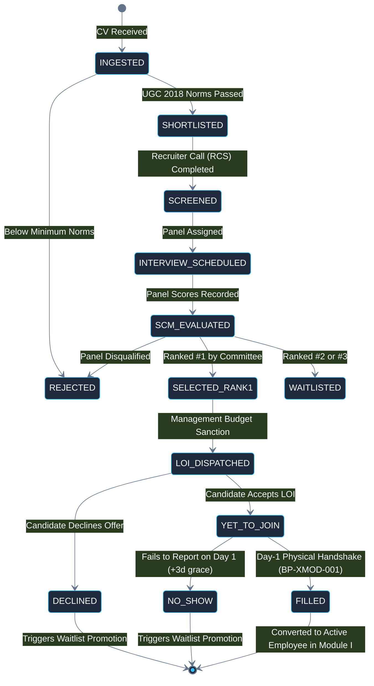

# The Neotia University
## Department of Technical & Academic Systems
### HR Change Management & Automation System (HRMS)

---

# Module II: Talent Acquisition & Workforce Planning
## End-to-End Graphic Workflow & Lifecycle Specification

| Document Metadata | Specification Detail |
|---|---|
| **Document Identifier** | `DOC-02-GIW-MOD2-CANONICAL` |
| **Project Name** | University HR Change Management & Automation System |
| **Module Covered** | **Module II — Talent Acquisition & Workforce Planning** |
| **Institution** | The Neotia University (TNU) |
| **Mentor** | Sandipan Chakraborty |
| **Date** | October 2026 |

---

## 1. Executive Summary & Module Scope

Module II provides end-to-end governance over the university's talent acquisition, workforce planning, and onboarding operations. It is designed around the statutory requirements of higher education recruitment (such as UGC 2018 guidelines and Selection Committee quorums) while enforcing streamlined SLAs. Its core components include:

1. **Multi-Channel Manpower Planning & Requisitions:**
   * *Channel A (Academic Faculty):* 4-month pre-semester cycle driven by Teaching Load Assessment Sheets (Attachment 1) and student-faculty ratios.
   * *Channel B (Non-Academic Staff):* Annual headcount planning enforcing a statutory quota of one planned MRF per department per year.
   * *Channel C (Urgent Resignation Bypass):* Cross-module trigger from Module I (`BP-XMOD-002`) bypassing annual quotas for immediate replacement recruitment.
2. **Omnichannel Candidate Sourcing & Automated Screening:** Ingestion across web portal, job boards, and campus drives, with automated screening against UGC 2018 criteria.
3. **Recruiter Calling Sheet (RCS) Telephonic Funnel:** Structured prescreening capturing expected CTC, notice periods, and communication ratings.
4. **Bifurcated Selection Pathways:**
   * *Statutory Academic SCM:* Chaired by Vice-Chancellor / Nominee with Deans, HODs, and mandatory External Subject Experts.
   * *Non-Academic 3-Round Assessment:* Sequential technical, HR behavioral, and leadership rounds.
5. **Offer Lifecycle & Day-1 Onboarding Handshake (`BP-XMOD-001`):** Ranked merit rosters, automated Letter of Intent (LOI) generation, 'Yet to Join' notice period monitoring, 90-day waitlist fallback activation, and Day-1 physical onboarding handshake into the Central Employee Database.

---

## 2. Graphic Workflow Diagram (Module II)

```mermaid
%%{init: {'theme': 'base', 'themeVariables': { 'primaryColor': '#1e293b', 'primaryTextColor': '#f8fafc', 'primaryBorderColor': '#38bdf8', 'lineColor': '#64748b', 'secondaryColor': '#0f172a', 'tertiaryColor': '#1e293b'}}}%%
flowchart TD
    %% Styling Classes
    classDef planNode fill:#1e1b4b,stroke:#818cf8,stroke-width:2px,color:#f8fafc;
    classDef acadNode fill:#2e1065,stroke:#c084fc,stroke-width:2px,color:#f8fafc;
    classDef staffNode fill:#064e3b,stroke:#34d399,stroke-width:2px,color:#f8fafc;
    classDef urgentNode fill:#451a03,stroke:#f97316,stroke-width:2px,color:#fff7ed;
    classDef decisionNode fill:#701a75,stroke:#f472b6,stroke-width:2px,color:#ffffff;
    classDef successNode fill:#0c4a6e,stroke:#38bdf8,stroke-width:2px,color:#f8fafc;
    classDef rejectNode fill:#450a0a,stroke:#f87171,stroke-width:2px,color:#fecaca;

    %% -------------------------------------------------------------
    %% PHASE 1: REQUISITION & MANPOWER INTAKE
    %% -------------------------------------------------------------
    subgraph P1 ["PHASE 1: MULTI-CHANNEL REQUISITION & SANCTION"]
        direction TB
        %% Channel A: Academic
        M2_ACAD_TRIG["<b>Channel A: Academic Manpower Cycle</b><br/><i>Calendar Trigger: 4 Months Pre-Semester (SLA-M2-01)</i>"]:::planNode
        M2_LOAD["<b>Teaching Load Assessment (Attachment 1)</b><br/><i>Deans submit workload & student-faculty ratios (15d SLA)</i>"]:::acadNode
        M2_HR_VET["<b>HR Curriculum & Ratio Vetting</b><br/><i>3-Month Window; Consolidated into Master Plan (Encl 1 & 3)</i>"]:::planNode
        M2_CHANC{"<b>Pro-Chancellor Sanction</b><br/><i>Strict 7-Day Turnaround SLA (SLA-M2-04)</i>"}:::decisionNode
        
        M2_ACAD_TRIG --> M2_LOAD --> M2_HR_VET --> M2_CHANC

        %% Channel B: Non-Academic
        M2_STAFF_TRIG["<b>Channel B: Non-Academic Annual Plan</b><br/><i>Triggered 4 Months Pre-Fiscal Year (SLA-M2-07)</i>"]:::planNode
        M2_STAFF_MRF["<b>Department Annual MRF</b><br/><i>Strict quota: 1 planned MRF/dept/year (15d SLA)</i>"]:::staffNode
        M2_STAFF_APP{"<b>HR & Registrar Approval</b>"}:::decisionNode
        
        M2_STAFF_TRIG --> M2_STAFF_MRF --> M2_STAFF_APP

        %% Channel C: Urgent Resignation Bypass
        M2_RESIGN["<b>Channel C: Resignation Accepted</b><br/><i>(Logged in Module I via BP-M1-011)</i>"]:::urgentNode
        M2_URG_MRF["<b>Urgent Replacement MRF (BP-XMOD-002)</b><br/><i>Bypasses annual quota; immediate countdown clock</i>"]:::urgentNode

        M2_RESIGN --> M2_URG_MRF
    end

    %% -------------------------------------------------------------
    %% PHASE 2: SOURCING & SCREENING
    %% -------------------------------------------------------------
    subgraph P2 ["PHASE 2: ADVERTISEMENT, OMNICHANNEL INGESTION & SCREENING"]
        direction TB
        M2_AD["<b>Public Recruitment Advertisement</b><br/><i>Print, Portals, LinkedIn, Internshala (7d SLA)</i>"]:::planNode
        M2_CV["<b>Omnichannel CV Ingestion Engine</b><br/><i>Central CV Repository with Deduplication</i>"]:::planNode
        M2_UGC{"<b>Automated UGC 2018 Screening</b><br/><i>Ph.D., NET, Min Marks, Experience Match</i>"}:::decisionNode
        M2_UGC_REJ["<b>Disqualified Pool</b><br/><i>Status: NOT_QUALIFIED (Archived per policy)</i>"]:::rejectNode
        M2_RCS["<b>Recruiter Calling Sheet (RCS)</b><br/><i>Telephonic CTC, Notice Period & Communication Rating</i>"]:::planNode

        M2_CHANC -- " Sanctioned " --> M2_AD
        M2_STAFF_APP -- " Approved " --> M2_AD
        M2_URG_MRF ==> M2_CV
        M2_AD ==> M2_CV --> M2_UGC
        M2_UGC -- " Below Norms " --> M2_UGC_REJ
        M2_UGC -- " UGC Qualified " --> M2_RCS
    end

    %% -------------------------------------------------------------
    %% PHASE 3: EVALUATION & SELECTION
    %% -------------------------------------------------------------
    M2_SPLIT{"<b>Cadre Selection Pathway</b>"}:::decisionNode
    M2_RCS ==> M2_SPLIT

    subgraph P3_ACAD ["PATHWAY A: ACADEMIC SELECTION COMMITTEE (SCM)"]
        direction TB
        M2_SCM_PANEL["<b>Statutory SCM Panel Session</b><br/>━━━━━━━━━━━━━━━━━━━━━━━━━━━━━<br/>• Vice-Chancellor / Nominee (Chair)<br/>• School Dean & Head of Department<br/>• Mandatory External Subject Expert (ACT-EXP)<br/>• Teaching Demo & Pedagogy Evaluation"]:::acadNode
        M2_SCM_SCORE["<b>Standardized Digital Matrix Compilation</b><br/><i>Subject Knowledge, Pedagogy, Research, Comm</i>"]:::acadNode
        M2_SCM_PANEL --> M2_SCM_SCORE
    end

    subgraph P3_STAFF ["PATHWAY B: NON-ACADEMIC 3-ROUND SELECTION"]
        direction TB
        M2_R1["<b>Round 1: Technical / Functional Test</b><br/><i>Role-specific operational competence</i>"]:::staffNode
        M2_R2["<b>Round 2: HR Behavioral Assessment</b><br/><i>Communication, cultural fit, stability</i>"]:::staffNode
        M2_R3["<b>Round 3: Executive Leadership Review</b><br/><i>Department Head & Administrative Officer</i>"]:::staffNode
        M2_R1 --> M2_R2 --> M2_R3
    end

    M2_SPLIT -- " Academic Faculty " --> M2_SCM_PANEL
    M2_SPLIT -- " Administrative Staff " --> M2_R1

    %% -------------------------------------------------------------
    %% PHASE 4: OFFER, PIPELINE & ONBOARDING
    %% -------------------------------------------------------------
    subgraph P4 ["PHASE 4: SANCTION, OFFER, PIPELINE & DAY-1 ONBOARDING"]
        direction TB
        M2_MERIT["<b>Ranked Merit Roster Formulation</b><br/><i>• Rank 1: Selected • Rank 2: Waitlist-1 • Rank 3: Waitlist-2</i>"]:::planNode
        M2_SANCTION{"<b>Management Budget Sanction</b>"}:::decisionNode
        M2_LOI["<b>Letter of Intent (LOI) Dispatched</b><br/><i>Auto-generated PDF with compensation & terms</i>"]:::successNode
        M2_YTJ["<b>'Yet to Join' Pipeline Tracking</b><br/><i>Notice period countdown & relocation checklist</i>"]:::successNode
        
        M2_DECLINE{"<b>Candidate Accepts LOI?</b>"}:::decisionNode
        M2_WAITLIST["<b>Waitlist Fallback Protocol (BR-M2-007)</b><br/><i>Promote Rank 2 within 90-day window</i>"]:::urgentNode

        M2_ONB["<b>Day-1 Handshake (BP-XMOD-001)</b><br/>━━━━━━━━━━━━━━━━━━━━━━━━━━━━━<br/>• Step 1: Central HR Physical Document Verification<br/>• Step 2: System generates official <code>employee_id</code><br/>• Step 3: Instantiates Active Record in Module I Master DB<br/>• Step 4: Biometric Enrollment & IT Account Setup<br/>• Step 5: Vacancy marked as FILLED on Tracker"]:::successNode

        M2_SCM_SCORE ==> M2_MERIT
        M2_R3 ==> M2_MERIT
        M2_MERIT --> M2_SANCTION --> M2_LOI --> M2_DECLINE
        M2_DECLINE -- " Candidate Declines / No-Show " --> M2_WAITLIST
        M2_WAITLIST -.->|" Issue LOI to Waitlist-1 "| M2_LOI
        M2_DECLINE -- " LOI Accepted " --> M2_YTJ --> M2_ONB
    end
```

---

## 3. Step-by-Step Workflow Walkthrough

### Phase 1: Requisition & Manpower Planning
* **Academic Planning Initiation:** Exactly 4 months before each academic semester, the system triggers the planning window, dispatching Teaching Load Assessment Sheets (Attachment 1) to all School Deans (`BP-M2-001`).
* **Workload Computation:** Deans calculate lecture, tutorial, and practical contact hours, factoring in projected student intake, and submit requisitions within 15 calendar days (`SLA-M2-02`).
* **HR Vetting & Master Plan:** Central HR conducts a 3-month comprehensive vetting of curriculum needs and compiles the consolidated Master Manpower Plan (Enclosures 1 & 3) (`BP-M2-004`).
* **Executive Sanction:** The Pro-Chancellor reviews and sanctions the plan with a strict 7-day turnaround SLA (`SLA-M2-04`).
* **Urgent Replacement Bypass (`BP-XMOD-002`):** When a resignation is accepted by a School Dean in Module I, the system immediately bypasses annual requisition limits and opens an urgent replacement MRF, initiating a countdown timer to fill the vacancy.

### Phase 2: Advertisement, Sourcing & Screening
* **Public Advertisements:** HR launches recruitment notices across print media, online job portals, LinkedIn, and Internshala within 7 days of executive sanction (`SLA-M2-05`).
* **CV Ingestion:** Resumes from all sources are ingested into the Central CV Repository (`ENT-MOD2-05`) with automated duplicate detection (`BP-M2-013`).
* **UGC 2018 Screening:** Automated rules engine checks candidate qualifications against UGC minimum norms (Ph.D., NET/SET, minimum 55% marks, post-qualification experience) (`BP-M2-014`). Non-qualifying resumes are routed to the Disqualified Pool.
* **Recruiter Calling Sheet (RCS):** Recruiters prescreen qualified candidates via telephone, recording current CTC, expected CTC, notice period duration, and communication competence in the RCS (`BP-M2-015`).

### Phase 3: Selection Pathways (Academic vs. Non-Academic)
* **Pathway A (Academic Faculty — Statutory SCM):**
  * The statutory Selection Committee Meeting is convened in compliance with university regulations (`BP-M2-016`).
  * *Panel Quorum:* Vice-Chancellor / Nominee (Chair), School Dean, Head of Department, and at least one independent **External Subject Expert** (`ACT-EXP`).
  * Candidates present research portfolios and conduct a teaching pedagogy demonstration.
  * Evaluators enter marks digitally across Subject Knowledge, Pedagogy, Research, and Communication, compiling a unified scorecard (`ATTR-SCM-08`).
* **Pathway B (Non-Academic Staff — 3-Round Assessment):**
  * Candidates undergo a sequential 3-round evaluation (`BP-M2-017`):
    * *Round 1:* Technical / Functional Competence Test.
    * *Round 2:* HR Behavioral & Communication Assessment.
    * *Round 3:* Executive Leadership & Department Head Interview.

### Phase 4: Offer, Pipeline & Day-1 Onboarding
* **Ranked Merit Panel:** Evaluators formulate a ranked merit roster:
  * *Rank 1:* Selected Candidate (Primary Offer).
  * *Rank 2:* Waitlist Candidate 1 (`WAITLIST_1`).
  * *Rank 3:* Waitlist Candidate 2 (`WAITLIST_2`).
* **LOI Issuance:** System auto-generates a formal PDF Letter of Intent (LOI) populated with compensation, designation, probation terms, and reporting deadline (`BP-M2-019`).
* **Yet to Join Pipeline Tracking:** Upon LOI acceptance, the candidate enters `YET_TO_JOIN`. The vacancy is marked as *reserved* on the Open Positions Tracker, and HR monitors notice period milestones (`BP-M2-020`).
* **Waitlist Fallback Protocol (`BR-M2-007`):** If the selected candidate declines or fails to report (`NO_SHOW`), HR triggers `ACTIVATE_WAITLIST_CANDIDATE`. Rank 2 is automatically promoted and issued an LOI without re-initiating recruitment, provided the 90-day validity window has not elapsed.
* **Day-1 Onboarding Handshake (`BP-XMOD-001`):** On the day of physical reporting:
  1. Central HR verifies original academic, identity, and statutory documents against the checklist.
  2. System mints the unique `employee_id` (`ATTR-EMP-01`).
  3. System creates the active record in `mod1_core.employees` and initializes the Digital Dossier.
  4. Candidate completes biometric registration and IT email setup.
  5. The vacancy is formally marked **`FILLED`** on the Open Positions Tracker.

---

## 4. Statutory Recruitment SLA Matrix

| SLA Identifier | Governed Process & Action | Mandatory Countdown / SLA Window | Breach Notification & Escalation Route |
|---|---|---|---|
| `SLA-M2-01` | **Academic Planning Trigger** | Exactly 4 Months Pre-Semester | Automated alert to Associate Dean (Academics) & HR Operations |
| `SLA-M2-02` | **Dean Workload Submission** | 15 Calendar Days from Trigger | Direct escalation to Pro-Chancellor & Registrar |
| `SLA-M2-03` | **HR Curriculum & Ratio Vetting** | 3-Month Comprehensive Window | Milestone briefing to Head of HR & Vice-Chancellor |
| `SLA-M2-04` | **Executive Sanction SLA** | Strict 7-Day Turnaround | Critical reminder to Pro-Chancellor & Senior Executive Office |
| `SLA-M2-05` | **Public Advertisement Launch** | 7 Calendar Days from Sanction | High-priority escalation ticket dispatched to Head of HR |
| `SLA-M2-06` | **Academic Hiring Conclusion** | 1 Month Prior to Semester Start | High-priority academic risk alert dispatched to Vice-Chancellor |
| `SLA-M2-07` | **Non-Academic Annual Initiation** | 4 Months Prior to Fiscal Year / DOJ | Automated dispatch of MRF templates to Department Heads |
| `SLA-M2-08` | **Department MRF Submission** | 15 Calendar Days from Trigger | Escalation alert dispatched to Registrar |
| `SLA-M2-09` | **Non-Academic Ad Launch** | 7 Calendar Days from Sanction | Operations reminder to HR Recruitment Cell |
| `SLA-M2-10` | **Non-Academic Hiring Conclusion**| 15 Days Prior to Onboarding Date | Facilities, IT, and workstation provisioning alert to HOD |

---

## 5. Candidate Lifecycle State Machine (Module II)

