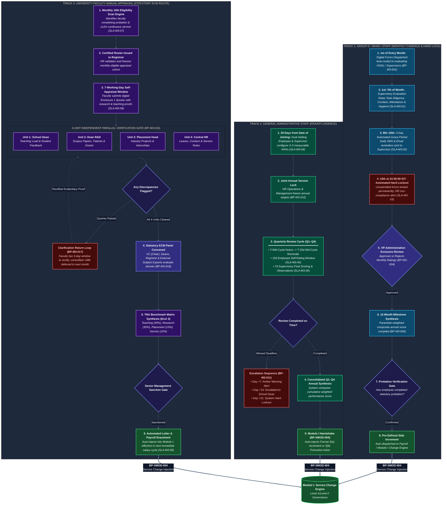

# The Neotia University
## Department of Technical & Academic Systems
### HR Change Management & Automation System (HRMS)

---

# Module III: 3-Track Performance Management Engine
## End-to-End Graphic Workflow & Lifecycle Specification

| Document Metadata | Specification Detail |
|---|---|
| **Document Identifier** | `DOC-02-GIW-MOD3-CANONICAL` |
| **Project Name** | University HR Change Management & Automation System |
| **Module Covered** | **Module III — 3-Track Performance Management Engine** |
| **Institution** | The Neotia University (TNU) |
| **Mentor** | Sandipan Chakraborty |
| **Date** | October 2026 |

---

## 1. Executive Summary & Module Scope

Module III automates performance evaluation across the university's diverse employment cadres through three segregated, non-interfering evaluation tracks:

1. **Track 1: Group-D / Band-I Operational Staff:** Monthly evaluation cadence with strict SLA enforcement:
   * 1st of month: Automated form dispatch to supervisors.
   * 7th of month: Standard submission deadline.
   * 8th–10th: 3-day automated grace period with daily SMS/Email chasers.
   * 10th at 23:59:59 IST: Automated hard lockout (`AUTO_LOCKED`); non-compliance flagged to HR.
   * VP-Administration exclusive approval authority.
   * Annual 12-month parameter-weighted average synthesis and increment disbursement.
2. **Track 2: General Administrative Staff (KRA/KPI Track):**
   * 30 days from Date of Joining: Joint goal-setting (3–5 measurable KRAs).
   * Joint version lock by HR and Senior Management.
   * Quarterly review cadence (Q1–Q4) with automated reminders and escalation ladder.
   * Annual consolidated scoring and automated Module I handshake (`BP-XMOD-004`).
3. **Track 3: Academic Faculty (Statutory ECM Route):**
   * Monthly 10th background scan identifying faculty with completed probation and $\ge 12$ months continuous service.
   * Certified eligibility roster issued to Registrar.
   * 7 working days for digital Self-Appraisal (Enclosure 1) submission.
   * **4-Unit Parallel Independent Verification Gate:** (1) School Dean, (2) Dean R&D, (3) Director of Placement & Internships, (4) Central HR Operations, featuring a 3-day dispute clarification return loop.
   * Monthly statutory Evaluation Committee Meeting (ECM) panel scoring.
   * TNU Protocol Benchmark Matrix (Enclosure 3) composite calculation: Teaching (40%), Research (30%), Placement (15%), Institutional Service (15%).
   * Executive management sanction, auto-generation of compensation revision letters, and payroll enactment via Module I.

---

## 2. Graphic Workflow Diagram (Module III)

---

## 3. Step-by-Step Workflow Walkthrough

### Track 1: Group-D / Band-I Staff Lifecycle
1. **1st of Month:** Background worker auto-dispatches digital evaluation forms (`ENT-MOD3-01`) to supervisors and HODs (`BP-M3-001`).
2. **1st–7th Due Date:** Supervisors evaluate attendance, conduct, task diligence, and cleanliness on structured 5-point rubrics (`BP-M3-002`, `SLA-M3-01`).
3. **8th–10th Grace Window:** Automated 3-day grace period with high-priority SMS and email alerts dispatched daily to supervisors (`SLA-M3-02`).
4. **10th at 23:59:59 IST Hard Lockout:** System executes an automated hard lock (`AUTO_LOCKED`). Unsubmitted forms lock permanently; an administrative non-compliance notice is auto-escalated to HR Operations (`REQ-MOD3-04`).
5. **VP-Administration Review:** Submitted evaluations route exclusively to the Vice President – Administration for executive sign-off (`BP-M3-004`).
6. **12-Month Anniversary Synthesis:** Exactly 1 year from the employee's Date of Joining (DOJ), the system calculates the 12-month parameter-weighted composite score (`BP-M3-006`).
7. **Probation Verification Gate:** The system verifies probation completion (`BR-M3-009`). If confirmed, predefined increment slabs are applied and dispatched to payroll via Module I (`BP-XMOD-004`).

### Track 2: General Administrative Staff (KRA/KPI Track)
1. **30-Day Goal Setting:** Within 30 calendar days from Date of Joining, the employee and supervisor formulate 3 to 5 measurable Key Result Areas (KRAs) with quantitative KPI targets (`BP-M3-009`, `SLA-M3-04`).
2. **Joint Version Lock:** HR Operations and Senior Management review and freeze the target sheet, rendering it immutable for the annual cycle (`BP-M3-010`).
3. **Quarterly Review Cadence (Q1–Q4):**
   * T-90 days: Advance quarterly cycle notice.
   * T-20 days: Mid-review reminder.
   * 15 calendar days: Employee self-rating submission window (`SLA-M3-05`).
   * 7 calendar days: Supervisory scoring, observations, and recommendations window (`SLA-M3-06`).
4. **Escalation Protocol:** If review is missed: Day 0 notice $\rightarrow$ Day +7 warning $\rightarrow$ Day +14 Dean escalation $\rightarrow$ Day +21 hard system lockout (`AUTO_LOCKED`). Unlocking requires formal approval from the Registrar.
5. **Annual Synthesis & Handshake:** Cumulative quarterly scores are synthesized into an annual rating, automatically injecting a Service Change Request (Format 3a or 3b) into Module I (`BP-XMOD-004`).

### Track 3: Academic Faculty (Statutory ECM Route)
1. **Monthly 10th Scan Engine:** Background worker executes on the 10th of every month, scanning for faculty who have completed probation and achieved $\ge 12$ months of continuous service (`BP-M3-014`, `SLA-M3-07`).
2. **Certified Roster:** HR verifies and dispatches the certified eligibility roster to the Registrar within 24 hours.
3. **7-Working-Day Self-Appraisal:** Qualified faculty submit a digital Enclosure 1 dossier containing evidence of publications, student feedback, and workloads within 7 working days (`BP-M3-015`, `SLA-M3-08`).
4. **4-Unit Independent Parallel Verification Gate:** Dossier routes simultaneously to:
   * *Unit 1 (School Dean):* Vetting teaching contact hours, pedagogy, and student feedback indices.
   * *Unit 2 (Dean R&D):* Verifying Scopus/SCI indexed papers, impact factors, patents, and funded grants.
   * *Unit 3 (Director of Placement & Internships):* Verifying industry projects, internships, and corporate linkages.
   * *Unit 4 (Central HR Operations):* Verifying leave records, statutory compliance, and university service history.
5. **Clarification Return Loop (`BP-M3-017`):** Verifying units can return queries (`RETURNED_FOR_CLARIFICATION`). Faculty have 3 working days to provide corrected proofs. Unresolved queries 48 hours prior to the scheduled ECM meeting cause the candidate's docket to be deferred to the subsequent monthly session, allowing cleared candidates to proceed.
6. **Statutory ECM Committee Session:** Panel convenes with Vice-Chancellor (Chair), School Deans, Registrar, and external subject experts. Committee members enter marks digitally in Enclosure 2 scorecards (`BP-M3-018`).
7. **TNU Benchmark Matrix Synthesis (Enclosure 3):** System calculates the composite score using the approved formula:
   $$\text{Composite Score} = (0.40 \times \text{Teaching}) + (0.30 \times \text{Research}) + (0.15 \times \text{Placement}) + (0.15 \times \text{Service})$$
8. **Sanction & Enactment:** Management sanctions the revision (Standard Increment, Accelerated Increment, Promotion, Confirmation, Probation Extension, or PIP). The system auto-generates formal revision letters and injects the change into Module I for enactment in the next immediate payroll cycle (`BP-XMOD-004`, `SLA-M3-09`).

---

## 4. Statutory Performance SLA Matrix

| SLA Identifier | Governed Performance Action | Statutory SLA Window / Cutoff | Escalation Pathway & Non-Compliance Action |
|---|---|---|---|
| `SLA-M3-01` | **Group-D Evaluation Due Date** | 7th of Every Month | System initiates 3-day grace period with reminder toasts |
| `SLA-M3-02` | **Group-D Grace Period Reminders** | Daily on 8th, 9th, and 10th | High-priority SMS and email alerts sent to evaluating supervisor |
| `SLA-M3-03` | **Group-D Automated Lockout** | 10th of Month at 23:59:59 IST | Form auto-locks permanently; non-compliance logged to HR |
| `SLA-M3-04` | **Staff KRA Goal Setting** | 30 Days from Date of Joining | Overdue alert dispatched to Direct Supervisor & Head of HR |
| `SLA-M3-05` | **Staff Quarterly Self-Review** | 15 Calendar Days from Open | Automated reminder to Employee & Direct Supervisor |
| `SLA-M3-06` | **Staff Supervisor Review Verification** | 7 Calendar Days from Self-Review | Escalation ticket dispatched to HR Operations Manager |
| `SLA-M3-07` | **Faculty Eligibility Scan** | 10th of Every Month at 00:01 IST | Automated generation and certified dispatch to Registrar |
| `SLA-M3-08` | **Faculty Self-Appraisal Submission** | 7 Working Days from Notice | Formal reminder to Faculty Member & School Dean |
| `SLA-M3-09` | **Faculty Increment Enactment** | Next Immediate Payroll Cycle | Financial discrepancy escalation to Chief Finance Officer |

---

## 5. Cross-Module Appraisal Outcome Handshake (`BP-XMOD-004`)

When Senior Management sanctions an appraisal outcome in Module III:
1. The system creates a pre-populated Change Request ticket in Module I (`ENT-MOD1-04`):
   * *Salary Increment:* Format 3(a) with new basic pay and effective date.
   * *Promotion:* Format 3(b) with new designation and grade band.
2. The ticket is tagged with source reference `SOURCE_MOD3_APPRAISAL` and the compiled scorecard metadata pointer (`ENT-SHR-05`).
3. The ticket bypasses redundant data entry and routes directly for midnight scheduled activation and ERP payroll synchronization.

