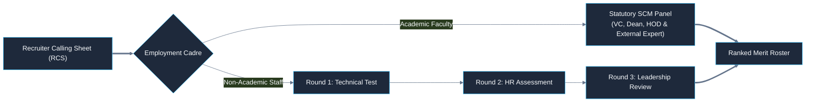

# The Neotia University
## Department of Technical & Academic Systems
### HR Change Management & Automation System (HRMS)

---

# Module II: Talent Acquisition & Workforce Planning
## Descriptive Operational Workflow Specification (Text Write-Up)

| Document Metadata | Specification Detail |
|---|---|
| **Document Identifier** | `DOC-02-TWU-MOD2-CANONICAL` |
| **Project Name** | University HR Change Management & Automation System |
| **Module Covered** | **Module II — Talent Acquisition & Workforce Planning** |
| **Institution** | The Neotia University (TNU) |
| **Mentor** | Sandipan Chakraborty |
| **Date** | October 2026 |

---

## 1. Executive Summary & Operational Mission

Module II governs the complete talent acquisition, workforce planning, candidate screening, statutory evaluation, offer issuance, and onboarding lifecycle for The Neotia University. In a higher education institution, recruitment is subject to strict regulatory frameworks—including University Grants Commission (UGC) minimum qualifications, statutory Selection Committee quorums, approved student-faculty ratios, and strict semester deadlines.

Operating recruitment through informal communications or unstandardized spreadsheets results in delayed faculty appointments, non-compliance with statutory selection norms, lack of pipeline visibility, and candidate drop-outs.

Module II establishes a synchronized digital recruitment engine. It supports three distinct requisition channels (Academic Semester Planning, Non-Academic Annual Quota, and Urgent Resignation Replacement), automated omnichannel CV ingestion, rule-based screening against UGC 2018 guidelines, telephonic pre-screening via the Recruiter Calling Sheet (RCS), bifurcated selection pathways (Statutory Academic SCM vs. Non-Academic 3-Round Assessment), automated Letter of Intent (LOI) issuance, 'Yet to Join' pipeline tracking with a 90-day waitlist fallback mechanism, and a seamless Day-1 onboarding handshake into Module I.

---

## 2. Participating Institutional Actors & Operational Roles

Talent acquisition involves coordinated interactions among seven primary stakeholder roles:

1. **Pro-Chancellor / Executive Management (`ACT-PRO`):** Apex executive authority; grants final sanction for consolidated academic and non-academic manpower plans, approves budgetary compensation bands, and authorizes appointment offers.
2. **Vice-Chancellor / Statutory Nominee (`ACT-VC`):** Statutory academic head; chairs the statutory Selection Committee Meetings (SCM) for academic faculty appointments.
3. **School Deans (`ACT-DEA`):** Academic executive heads; calculate semester teaching workloads (Attachment 1), define faculty specializations, participate in SCM panels, and log resignation acceptances.
4. **Department Heads (`ACT-HOD`):** Operational managers; submit non-academic Manpower Requisition Forms (MRFs), conduct technical interviews for staff, and participate in academic SCM sessions.
5. **Head of Human Resources & HR Operations (`ACT-HHR` / `ACT-HRO`):** Manages recruitment operations, vets curriculum workload models, launches public recruitment notices, oversees recruiter calling sheets, coordinates panels, generates LOIs, and conducts Day-1 verification.
6. **External Subject Experts (`ACT-EXP`):** Independent domain specialists from reputed external universities/institutions; mandatory statutory members of faculty Selection Committees who digitally score candidate subject competence and research pedagogy.
7. **Job Candidates (`ACT-CAN`):** Applicants submitting digital resumes, completing telephonic screening, attending evaluation sessions, accepting digital LOIs, and reporting for Day-1 onboarding.

---

## 3. Multi-Channel Requisition Intake & Sanction Lifecycle

The system provides three distinct intake channels to initiate hiring:

### Channel A: Academic Manpower Planning Cycle (4-Month Lead Cycle)
1. **Planning Trigger (`BP-M2-001`, `SLA-M2-01`):** Exactly four (4) months prior to the commencement of each academic semester, the system triggers the planning window, dispatching standardized Teaching Load Assessment Sheets (Attachment 1) to all School Deans.
2. **Workload Assessment & Requisition Submission (`BP-M2-002`, `SLA-M2-02`):** Deans compute semester contact hours (lectures, tutorials, practicals), factor in projected student intake, and determine required faculty headcounts across ranks (Professor, Associate Professor, Assistant Professor). Deans submit their requisitions within 15 calendar days.
3. **Comprehensive HR Vetting Window (`BP-M2-003`, `SLA-M2-03`):** Central HR spends up to three (3) months reviewing course curricula, verifying student-faculty ratios against statutory regulatory caps, checking existing departmental faculty allocations, and synthesizing requirements into a unified Master Manpower Plan (Enclosures 1 & 3).
4. **Pro-Chancellor Sanction (`BP-M2-005`, `SLA-M2-04`):** The consolidated Master Manpower Plan routes to the Pro-Chancellor with a mandatory 7-day turnaround SLA. Upon executive approval, the sanctioned headcount quota is locked into the system.

### Channel B: Non-Academic Annual Headcount Quota Cycle
1. **Annual Trigger (`BP-M2-007`, `SLA-M2-07`):** HR initiates the annual administrative staffing planning four (4) months prior to the start of the financial year.
2. **Departmental MRF Submission (`BP-M2-008`, `SLA-M2-08`):** Department Heads submit planned MRFs within 15 calendar days. The system enforces a strict business rule: *only one (1) planned MRF per department per year is permitted* (`BR-M2-009`).
3. **Administrative Approval (`BP-M2-009`):** Requisitions route to the Head of HR and Registrar for operational clearance and budget allocation.

### Channel C: Urgent Resignation Replacement Bypass (`BP-XMOD-002`)
1. **Separation Trigger:** When an employee tenders resignation and the School Dean formally accepts it in Module I, the system logs the separation date.
2. **Immediate Bypass (`BP-M2-011`):** Module I invokes cross-module handshake `BP-XMOD-002`. This bypasses annual requisition limits and automatically instantiates an **Urgent Replacement MRF** in Module II.
3. **Countdown Clock:** The system activates an urgent recruitment countdown timer on the Open Positions Tracker, alerting HR to initiate sourcing immediately to prevent instructional disruption.

---

## 4. Sourcing, Ingestion & Automated Screening

### Public Recruitment Notice Launch (`BP-M2-006`, `SLA-M2-05`)
Within seven (7) calendar days of executive sanction, HR Operations launches official advertisements across print national newspapers, university web portals, LinkedIn Talent Solutions, and student-intern platforms (such as Internshala).

### Omnichannel CV Ingestion & Deduplication (`BP-M2-013`)
Resumes arriving via the university application portal, email inboxes, recruitment agencies, and job boards are ingested into the Central CV Repository (`ENT-MOD2-05`). The ingestion engine extracts candidate contact details, academic credentials, and career timelines. It applies deduplication algorithms (matching email, phone, and PAN/Aadhaar hashes) to prevent duplicate profiles and preserve candidate application history.

### Automated UGC 2018 Screening Engine (`BP-M2-014`)
Ingested CVs pass through an automated rules filter configured with UGC 2018 Minimum Qualifications:
* *Assistant Professor:* Master's degree with $\ge 55\%$ marks in relevant discipline, plus qualifying UGC/CSIR NET/SET or a regular Ph.D. degree compliant with UGC 2009/2016 regulations.
* *Associate Professor:* Master's and Ph.D. in relevant discipline, minimum 8 years of teaching/research experience, and minimum mandatory peer-reviewed / UGC-CARE publications.
* *Professor:* Ph.D., minimum 10 years experience, successful Ph.D. scholar supervision, and minimum research score benchmarks.
Resumes meeting the minimum criteria transition to `SHORTLISTED`; unqualified resumes are tagged `NOT_QUALIFIED` and archived into the disqualified talent pool per university retention policy (`REQ-TBD-11`).

### Recruiter Calling Sheet (RCS) Phone Screening Funnel (`BP-M2-015`)
Recruiters engage shortlisted candidates via structured telephonic interviews, capturing essential baseline parameters in the Recruiter Calling Sheet (`ENT-MOD2-06`):
1. Candidate willingness to relocate to The Neotia University campus.
2. Current Cost-to-Company (CTC) and expected compensation.
3. Notice period duration with current employer.
4. Qualitative rating of spoken communication and pedagogical articulation.
Candidates scoring above threshold are green-lit for interview panel scheduling.

---

## 5. Bifurcated Statutory Selection Pathways

Depending on employment cadre, candidates route through one of two distinct evaluation pathways:

### Pathway A: Academic Faculty — Statutory Selection Committee Meeting (SCM) (`BP-M2-016`)
1. **Statutory Panel Constitution:** The SCM panel is formally convened in strict compliance with university governance rules (`BR-M2-004`).
   * *Chair:* Vice-Chancellor or statutory Chancellor's nominee.
   * *Institutional Members:* School Dean and Department Head.
   * *Mandatory External Authority:* At least one independent **External Subject Expert** (`ACT-EXP`) specialized in the academic domain.
2. **Pedagogy & Research Evaluation:** Candidates present their research portfolios and deliver a live 20-minute classroom teaching demonstration before the committee.
3. **Digital Scorecard Compilation:** Committee members enter scores digitally across four standardized parameters:
   * Subject Matter Mastery & Technical Depth (30 marks)
   * Teaching Pedagogy, Presentation & Communication (30 marks)
   * Research Publications, Grants & Patents Portfolio (25 marks)
   * Alignment with Institutional Goals & Accreditation Support (15 marks)
4. **Compiled Composite Matrix:** The system compiles evaluator marks into a unified score (`ATTR-SCM-08`), automatically flagging any statutory quorum deficiencies.

### Pathway B: Non-Academic Staff — 3-Round Sequential Evaluation (`BP-M2-017`)
Candidates for administrative, technical, and operational roles undergo a 3-round sequential assessment:
* *Round 1 (Technical & Functional Assessment):* Role-specific test administered by the Department Head evaluating domain competence.
* *Round 2 (HR Behavioral & Cultural Fit):* In-depth interview by HR Operations assessing interpersonal communication, workplace ethics, and career stability.
* *Round 3 (Executive Leadership Review):* Final evaluation by the Registrar or Administrative Officer confirming organizational alignment.

---

## 6. Offer Sanction, Pipeline Tracking & Onboarding

### Ranked Merit Roster Formulation
Following panel evaluations, the system compiles candidate scores into a ranked merit roster:
* *Rank 1:* Selected Candidate (Primary Offer).
* *Rank 2:* Waitlisted Candidate 1 (`WAITLIST_1`).
* *Rank 3:* Waitlisted Candidate 2 (`WAITLIST_2`).

### Management Budget Sanction & LOI Issuance (`BP-M2-018`, `BP-M2-019`)
The compiled docket routes to Senior Management for compensation approval. Upon executive clearance, the system auto-generates a personalized, formal **Letter of Intent (LOI)** PDF (`ATTR-LOI-01`). The LOI details offered designation, basic salary, allowances, probation duration, expected reporting date, and required Day-1 compliance documents.

### The 'Yet to Join' Pipeline & Notice Period Tracking (`BP-M2-020`)
Upon the candidate's digital acceptance of the LOI:
1. Candidate status updates to `YET_TO_JOIN`.
2. The vacancy is marked as *reserved* on the Open Positions Tracker (`ATTR-OPP-08`), preventing duplicate hiring pipelines.
3. HR Operations tracks the candidate's notice period countdown clock, maintaining weekly contact, coordinating campus housing requests, and provisioning departmental equipment.

### Waitlist Fallback Protocol (`BR-M2-007`)
If the selected candidate (Rank 1) formally declines the offer or fails to report on the designated reporting date (plus an authorized 3-day grace period):
1. Candidate status transitions to `DECLINED` or `NO_SHOW`.
2. The system triggers `ACTIVATE_WAITLIST_CANDIDATE`.
3. If the Selection Committee date is within **90 calendar days**, HR Operations can immediately promote Rank 2 (`WAITLIST_1`) to selected status and issue an LOI without re-advertising the post or reconvening the committee.
4. If the 90-day window has expired, the position re-opens, requiring a fresh recruitment requisition.

### Day-1 Physical Onboarding Handshake (`BP-XMOD-001`)
On the candidate's physical reporting date, the system executes the cross-module onboarding handshake:
1. **Document Verification:** Central HR inspects original academic degrees, experience certificates, identity documents (Aadhaar/PAN), and background checks against the pre-onboarding compliance checklist.
2. **Employee ID Minting:** The system mints a permanent, globally unique University Employee Code (`ATTR-EMP-01`).
3. **Master Database Instantiation:** The system automatically instantiates a new record in `mod1_core.employees`, anchors the new employee to their designated department and supervisor in `mod1_core.org_nodes`, and creates the initial Digital Personal Dossier (`mod1_core.digital_dossiers`).
4. **Biometric & IT Setup:** Candidate is enrolled in the university biometric attendance machines and issued official Google Workspace / Microsoft 365 credentials.
5. **Tracker Resolution:** The vacancy status on the Open Positions Tracker updates from `RESERVED` to **`FILLED`**.

---

## 7. Statutory Recruitment SLA Matrix

| SLA Identifier | Governed Action | Cutoff Timeline | Escalation & Non-Compliance Protocol |
|---|---|---|---|
| `SLA-M2-01` | **Academic Planning Trigger** | Exactly 4 Months Pre-Semester | Automated notice to Associate Dean (Academics) & HR Operations |
| `SLA-M2-02` | **Dean Workload Submission** | 15 Calendar Days from Trigger | Direct escalation to Pro-Chancellor & Registrar |
| `SLA-M2-03` | **HR Curriculum & Ratio Vetting** | 3-Month Comprehensive Window | Executive briefing to Head of HR & Vice-Chancellor |
| `SLA-M2-04` | **Executive Sanction SLA** | Strict 7-Day Turnaround | Critical reminder dispatched to Pro-Chancellor's Office |
| `SLA-M2-05` | **Public Advertisement Launch** | 7 Calendar Days from Sanction | High-priority escalation ticket to Head of HR |
| `SLA-M2-06` | **Academic Hiring Conclusion** | 1 Month Prior to Semester Start | Academic staffing risk alert dispatched to Vice-Chancellor |
| `SLA-M2-07` | **Non-Academic Annual Initiation**| 4 Months Prior to Fiscal Year / DOJ | Automated dispatch of MRF templates to Department Heads |
| `SLA-M2-08` | **Department MRF Submission** | 15 Calendar Days from Trigger | Escalation alert dispatched to Registrar |
| `SLA-M2-09` | **Non-Academic Ad Launch** | 7 Calendar Days from Sanction | Operations reminder to HR Recruitment Cell |
| `SLA-M2-10` | **Non-Academic Hiring Conclusion**| 15 Days Prior to Onboarding Date | Facilities, IT, and workstation provisioning alert to HOD |

---

## 8. Cross-Module Architectural Handshakes

1. **`BP-XMOD-001` (Candidate Onboarding Handshake):** Converts a candidate in `YET_TO_JOIN` state into an active master record in Module I upon Day-1 document verification, minting the permanent `employee_id`.
2. **`BP-XMOD-002` (Resignation Replacement Bypass):** Module I triggers an immediate urgent replacement MRF in Module II when an employee resignation is formally accepted by a School Dean.
