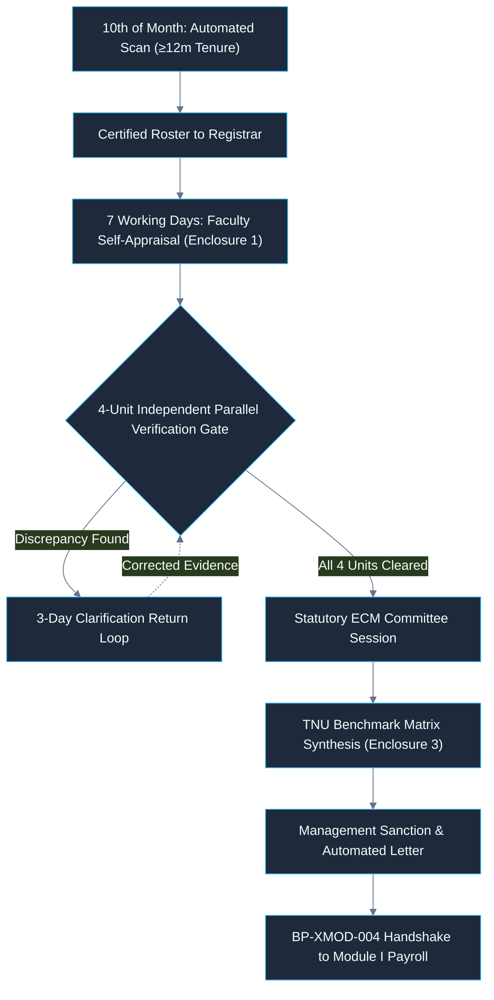

# The Neotia University
## Department of Technical & Academic Systems
### HR Change Management & Automation System (HRMS)

---

# Module III: 3-Track Performance Management Engine
## Descriptive Operational Workflow Specification (Text Write-Up)

| Document Metadata | Specification Detail |
|---|---|
| **Document Identifier** | `DOC-02-TWU-MOD3-CANONICAL` |
| **Project Name** | University HR Change Management & Automation System |
| **Module Covered** | **Module III — 3-Track Performance Management Engine** |
| **Institution** | The Neotia University (TNU) |
| **Mentor** | Sandipan Chakraborty |
| **Date** | October 2026 |

---

## 1. Executive Summary & Operational Mission

Module III provides automated, objective, and auditable performance evaluation governance tailored to the diverse employment cadres of The Neotia University. In a comprehensive university environment, evaluating faculty, administrative officers, and facility staff under a single generic appraisal instrument leads to invalid assessments, administrative delays, and non-compliance with statutory promotion criteria.

To eliminate subjective bias and enforce rigorous accountability, Module III partitions university personnel into three strictly segregated, non-interfering evaluation tracks:

1. **Track 1: Group-D / Band-I Staff:** Monthly operational review cadence governed by automated form dispatch, 3-day grace periods, a hard automated system lockout at 23:59:59 IST on the 10th of every month, exclusive executive review by the Vice President – Administration, and 12-month anniversary increment formulations.
2. **Track 2: General Administrative Staff (KRA/KPI Cadence):** Annual goal setting locked within 30 days of joining, quarterly review intervals (Q1 through Q4), automated overdue escalation sequences, and cumulative annual score synthesis.
3. **Track 3: Academic Faculty (Statutory ECM Route):** Monthly automated background scans identifying faculty completing probation and $\ge 12$ months of continuous service, 7-working-day digital self-appraisal submissions, a 4-Unit Independent Parallel Verification Gate with an evidentiary dispute loop, statutory Evaluation Committee Meetings (ECM) chaired by the Vice-Chancellor with External Subject Experts, and composite scoring mapped against the approved TNU Protocol Benchmark Matrix.

Approved appraisal outcomes across all three tracks automatically trigger cross-module service change requests in Module I (`BP-XMOD-004`), ensuring seamless, automated reflection in the University ERP payroll system.

---

## 2. Participating Institutional Actors & Operational Roles

Performance management execution involves eight key institutional stakeholders:

1. **Vice-Chancellor / Statutory Nominee (`ACT-VC`):** Statutory head; chairs the statutory faculty Evaluation Committee Meetings (ECM) and sanctions promotional progressions.
2. **Vice President – Administration (`ACT-VPA`):** Exclusive executive authority responsible for reviewing, endorsing, or rejecting all monthly Group-D / Band-I evaluations (`ACT-GPD`).
3. **Registrar (`ACT-REG`):** Receives monthly certified faculty eligibility rosters, issues official appraisal notifications, and dockets verified dossiers for monthly ECM convening.
4. **School Deans (`ACT-DEA`):** Vets faculty teaching contact hours, pedagogy, and student feedback indices (Unit 1 Verification); acts as escalation authority for overdue administrative staff reviews.
5. **Dean of Research & Development (`ACT-RND`):** Independently audits faculty research publication claims, verifying Scopus/SCI citations, impact factors, patents, and funded research grants (Unit 2 Verification).
6. **Director of Corporate Relations & Placements (`ACT-PLA`):** Vets student corporate internships, placements, and industry collaborations achieved by academic departments (Unit 3 Verification).
7. **Head of Human Resources & HR Operations (`ACT-HHR` / `ACT-HRO`):** Conducts service history vetting (Unit 4 Verification), monitors SLA countdowns, handles administrative lockouts, and executes cross-module change tickets into Module I.
8. **Direct Supervisors & Department Heads (`ACT-HOD`):** Complete monthly Group-D staff scorecards, formulate KRA/KPI targets with administrative staff, and conduct quarterly review assessments.

---

## 3. Track 1: Group-D / Band-I Operational Staff Workflow Narrative

Track 1 governs facility personnel, maintenance staff, laboratory attendants, security guards, and hostel support staff who require continuous operational oversight rather than lengthy annual self-appraisal narratives.

### Monthly Operational Cycle Walkthrough (`BP-M3-001` to `BP-M3-008`)
1. **Automated Dispatch (1st of Every Month):** At 00:01 IST on the 1st of every calendar month, the system background engine (`ACT-SYS`) auto-generates digital Evaluation Forms (`ENT-MOD3-01`) for all active Group-D personnel and routes them to the inboxes of their evaluating supervisors or HODs (`BP-M3-001`).
2. **Supervisory Rating (1st to 7th of Month):** Supervisors evaluate workers across four standardized 5-point rubric parameters (`BP-M3-002`, `SLA-M3-01`):
   * *Task Diligence & Work Quality:* Punctuality, physical stamina, and accuracy of assigned tasks.
   * *Conduct & Discipline:* Respectful communication, adherence to safety standards, and team cooperation.
   * *Attendance & Punctuality:* Roster adherence and shift compliance extracted from biometric records.
   * *Personal Hygiene & Campus Cleanliness:* Proper uniform compliance and facility sanitation standards.
3. **Automated Grace Period & Reminders (8th to 10th of Month):** If a supervisor fails to submit by 23:59 on the 7th, the system transitions the form to `GRACE_PERIOD`. The system dispatches automated high-priority SMS and email chaser alerts daily on the 8th, 9th, and 10th (`SLA-M3-02`).
4. **Hard Automated System Lockout (10th at 23:59:59 IST):** At exactly 23:59:59 IST on the 10th, the system background worker executes an unyielding hard lock (`AUTO_LOCKED`) (`SLA-M3-03`).
   * *Unsubmitted Forms:* Permanently locked against late edits. An automated non-compliance penalty notice is dispatched to Central HR and the Registrar.
   * *Unlocking Restriction:* Forms cannot be unlocked by supervisors. Unlocking requires a formal, written **Administrative Exception Override** signed by the Registrar with reasons captured in the immutable audit log (`ENT-SHR-07`).
5. **VP-Administration Exclusive Review (`BP-M3-004`):** All submitted monthly forms route exclusively to the Vice President – Administration. The VP-Admin approves, modifies, or rejects ratings.
6. **Monthly Collation:** Approved evaluations are compiled into monthly reports (`ENT-MOD3-02`) for Central HR archiving.
7. **12-Month Anniversary Synthesis & Increment Disbursement (`BP-M3-006`):**
   * Exactly 12 months from the employee's Date of Joining (DOJ), the system calculates the 12-month parameter-weighted composite average score.
   * *Probation Gate:* The system checks whether the employee has cleared statutory probation (`BR-M3-009`). If confirmed, the system maps the score against institutional compensation revision slabs (`REQ-TBD-05`).
   * *Payroll Injection:* The system auto-generates a Format 3(a) Service Change ticket in Module I (`BP-XMOD-004`), enacting the increment in the next immediate payroll cycle.

---

## 4. Track 2: General Administrative Staff (KRA/KPI Track) Narrative

Track 2 governs administrative officers, finance executives, IT engineers, admissions counselors, and departmental coordinators whose work is structured around measurable deliverables and key performance indicators.

### Annual Goal-Setting & Joint Locking Phase (`BP-M3-009`, `BP-M3-010`)
1. **30-Day Goal Setting Window:** Within thirty (30) calendar days from the Date of Joining (DOJ), newly onboarded staff collaborate with their direct supervisor to configure three (3) to five (5) Key Result Areas (KRAs) in the system (`SLA-M3-04`).
2. **Quantitative Target Definition:** Each KRA is assigned specific Key Performance Indicators (KPIs), quantitative metrics (e.g., student admission conversion rate, invoice processing turnaround, network uptime percentage), and percentage weightages summing to exactly 100%.
3. **Joint Version Lock:** The proposed goal sheet routes to Central HR and Senior Management. Upon executive sign-off, the goal sheet transitions to `LOCKED`. The targets become immutable for the 12-month appraisal cycle.

### Quarterly Review Cadence (Q1 to Q4) & Escalation Ladder (`BP-M3-011`)
Reviews execute on an automated 90-day cycle tied to the employee's anniversary date:
1. **Advance Notification (Day -90):** System issues an automated quarterly cycle opening notice.
2. **Mid-Review Reminder (Day -20):** System reminds employee and supervisor to compile performance metrics.
3. **Employee Self-Rating Window (15 Calendar Days):** The staff member enters actual accomplishments against locked KPI targets, provides narrative justifications, and assigns self-ratings on a 5-point scale (`SLA-M3-05`).
4. **Supervisory Verification Window (7 Calendar Days):** The direct supervisor reviews accomplishments, enters supervisory scores, records observations, and conducts a 1-on-1 performance dialogue (`SLA-M3-06`).
5. **Automated Escalation Protocol (`REQ-SLA-08`):** If a quarterly review is delayed:
   * *Day 0 (Due Date):* System sends immediate alerts to employee and supervisor.
   * *Day +7:* Review status updates to `REVIEW_OVERDUE`; amber warning toasts appear on dashboards.
   * *Day +14:* Overdue notice is automatically escalated to the School Dean / Administrative Director.
   * *Day +21:* System executes an automated hard lock (`AUTO_LOCKED`). Submission can only be restored via written Registrar override.

### Annual Consolidated Synthesis & Module I Handshake (`BP-M3-013`)
At the conclusion of the fourth quarter (Q4):
1. The system computes a cumulative, weighted annual composite score across all four quarterly cycles.
2. Central HR reviews the annual performance rating, appending observations regarding training needs or potential promotions.
3. Upon Senior Management sign-off, the system triggers cross-module handshake `BP-XMOD-004`. It injects a pre-populated Service Change Request (Format 3a for Increment, Format 3b for Promotion) into Module I, routing directly for midnight activation and ERP synchronization.

---

## 5. Track 3: Academic Faculty (Statutory ECM Route) Narrative

Track 3 governs professors, associate professors, and assistant professors. It is designed around the statutory requirements of academic governance, balancing teaching pedagogy, research productivity, student mentorship, and institutional service.

### Stage 1: Monthly 10th Eligibility Scan Engine (`BP-M3-014`, `SLA-M3-07`)
At 00:01 IST on the 10th of every calendar month, an automated background scanner evaluates `mod1_core.employees`:
1. *Eligibility Invariants (`BR-M3-014`):*
   * Employment category is Academic Faculty.
   * Statutory probation period is formally marked `CONFIRMED`.
   * Continuous service duration from Date of Joining (or last formal appraisal milestone) is $\ge 12$ months (365 days).
2. *Roster Dispatch:* Eligible faculty are compiled into a Certified Appraisal Roster and transmitted to the Registrar within 24 hours.

### Stage 2: 7-Working-Day Digital Self-Appraisal Submission (`BP-M3-015`, `SLA-M3-08`)
Eligible faculty receive an automated notification with access to the digital Self-Appraisal Dossier (**Enclosure 1**). Within seven (7) working days, the faculty member must submit comprehensive evidence across four domains:
* *Teaching & Pedagogy:* Completed lecture, tutorial, and practical contact hours; syllabus completion reports; innovative pedagogy tools adopted; and student feedback indices.
* *Research & Scholarly Contributions:* Peer-reviewed publications in Scopus/Web of Science / UGC-CARE journals; authored books/chapters; funded research grants; and patents filed/granted.
* *Industry Linkages & Internships:* Corporate internships facilitated; student placement drives coordinated; and executive consultancy projects executed.
* *Institutional Service & Governance:* Participation in NAAC/NBA accreditation committees, examination duties, student club mentorship, and administrative responsibilities.

### Stage 3: The 4-Unit Independent Parallel Verification Gate (`BP-M3-016`)
To eliminate unilateral administrative bias, submitted dossiers route simultaneously to four independent verifiers:

1. **Unit 1 — School Dean:** Audits teaching contact hours, laboratory sessions, syllabus coverage, and student feedback ratings.
2. **Unit 2 — Dean of Research & Development:** Rigorously verifies all publication claims, checking Scopus/SCI indexing, impact factors, patent numbers, and research grant accounts in university finance.
3. **Unit 3 — Director of Placement & Corporate Relations:** Vets corporate internship verifications, student placement figures, and industry collaboration agreements.
4. **Unit 4 — Central HR Operations:** Verifies leave records, statutory service compliance, attendance logs, and disciplinary clearance.

### Stage 4: Dispute Clarification Return Loop (`BP-M3-017`)
If any verifying unit identifies a factual discrepancy (e.g., an unverified journal publication or an inflated student feedback claim):
1. The verifying unit tags the specific claim as `RETURNED_FOR_CLARIFICATION` and inputs formal query remarks.
2. The dossier enters the clarification loop. The faculty member receives an instant alert and is granted a **3-working-day remediation window** to upload amended certificates or textual justifications.
3. Verified sections remain locked; only queried fields are open for editing.
4. **48-Hour Pre-Meeting Cutoff Rule (`BR-M3-016`):**
   * If all four units sign off at least **48 hours prior** to the convened ECM panel meeting, the candidate proceeds in the current monthly docket.
   * If queries remain unresolved 48 hours prior to the meeting, the candidate's docket is automatically deferred to the subsequent month's session.
   * Other cleared faculty in the cohort proceed without disruption, preventing administrative paralysis.

### Stage 5: Statutory ECM Committee Session & Digital Scoring (`BP-M3-018`)
1. **Statutory Quorum:** The Evaluation Committee Meeting (ECM) is formally convened:
   * *Chair:* Vice-Chancellor or statutory nominee.
   * *Members:* School Dean, Department Head, and Registrar.
   * *External Oversight:* Mandatory external academic domain experts (`ACT-EXP`).
2. **Candidate Presentation:** Faculty members deliver a 15-minute presentation summarizing teaching innovations and research milestones, followed by an interview with the panel.
3. **Digital Scorecard Entry:** Committee members enter individual marks digitally into Enclosure 2 scorecards across pedagogy, research depth, institutional commitment, and future vision.

### Stage 6: TNU Benchmark Matrix Synthesis (`BP-M3-019`)
The system synthesizes the individual scorecards, computing the final composite score based on the approved TNU Protocol Benchmark Matrix (**Enclosure 3**):

$$\text{TNU Composite Score} = (\text{Teaching} \times 0.40) + (\text{Research} \times 0.30) + (\text{Placement} \times 0.15) + (\text{Institutional Service} \times 0.15)$$

### Stage 7: Executive Sanction, Letter Generation & Payroll Enactment (`BP-M3-020`, `BP-M3-021`)
1. **Outcome Determination:** Executive leadership reviews composite scores and determines outcomes based on pre-defined slabs:
   * *Accelerated Increment:* $\ge 90\%$ composite score.
   * *Standard Merit Increment:* $75\% - 89\%$ composite score.
   * *Basic Increment / Retention:* $60\% - 74\%$ composite score.
   * *Performance Improvement Plan (PIP) / Probation Extension:* $< 60\%$ composite score.
   * *Promotional Elevation:* Reclassification to Associate Professor / Professor based on statutory UGC service years and publication thresholds.
2. **Automated Letter Generation:** System auto-generates a personalized, digitally signed Compensation Revision / Promotion Letter PDF, archiving it in the employee's Digital Dossier in Module I.
3. **Payroll Injection (`BP-XMOD-004`, `SLA-M3-09`):** System creates a pre-populated Service Change ticket (Format 3a / 3b) in Module I. The increment takes effect in the next immediate payroll cycle.

---

## 6. Cross-Module Appraisal Outcome Handshake (`BP-XMOD-004`)

When Senior Management sanctions an appraisal outcome in Module III:
1. The system creates a pre-populated Change Request ticket in Module I (`ENT-MOD1-04`):
   * *Salary Increment:* Format 3(a) with new basic pay and effective date.
   * *Promotion:* Format 3(b) with new designation and grade band.
2. The ticket is tagged with source reference `SOURCE_MOD3_APPRAISAL` and the compiled scorecard metadata pointer (`ENT-SHR-05`).
3. The ticket bypasses redundant data entry and routes directly for midnight scheduled activation and ERP payroll synchronization.

---

## 7. Statutory Performance SLA & Auto-Lockout Matrix

| SLA Identifier | Governed Performance Action | Cutoff Timeline | Escalation & Non-Compliance Protocol |
|---|---|---|---|
| `SLA-M3-01` | **Group-D Evaluation Due Date** | 7th of Every Month | System enters 3-day grace period with reminder notifications |
| `SLA-M3-02` | **Group-D Grace Period Reminders** | Daily on 8th, 9th, and 10th | High-priority SMS and email alerts dispatched to supervisor |
| `SLA-M3-03` | **Group-D Automated Hard Lockout**| 10th of Month at 23:59:59 IST | Form permanently locks (`AUTO_LOCKED`); HR non-compliance alert |
| `SLA-M3-04` | **Staff KRA Goal Setting** | 30 Days from Date of Joining | Overdue alert dispatched to Direct Supervisor & Head of HR |
| `SLA-M3-05` | **Staff Quarterly Self-Review** | 15 Calendar Days from Open | Automated reminder to Employee & Direct Supervisor |
| `SLA-M3-06` | **Staff Supervisor Review Verification** | 7 Calendar Days from Self-Review | Escalation ticket dispatched to HR Operations Manager |
| `SLA-M3-07` | **Faculty Eligibility Scan** | 10th of Every Month at 00:01 IST | Automated generation and certified dispatch to Registrar |
| `SLA-M3-08` | **Faculty Self-Appraisal Submission** | 7 Working Days from Notice | Formal reminder to Faculty Member & School Dean |
| `SLA-M3-09` | **Faculty Increment Enactment** | Next Immediate Payroll Cycle | Financial discrepancy escalation to Chief Finance Officer |
